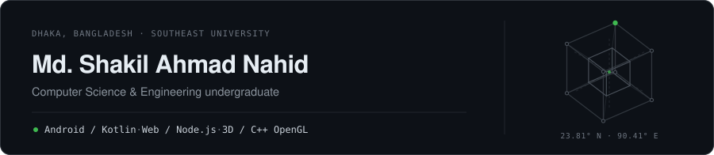
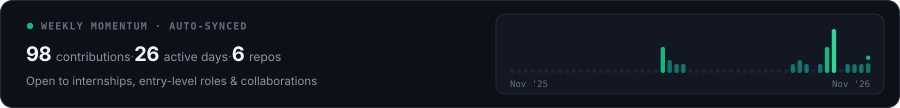

<picture>
  <source media="(prefers-color-scheme: dark)" srcset="assets/profile/header-dark.svg" />
  <source media="(prefers-color-scheme: light)" srcset="assets/profile/header-light.svg" />
  
</picture>

 

I'm **Md. Shakil Ahmad Nahid**, a Computer Science & Engineering student at **Southeast University** in Dhaka. Most of my time goes into building native Android apps in Kotlin, web tools in JavaScript and Node.js, and occasional graphics projects in C++ and OpenGL.

Before focusing on software, I worked in sales, customer service, and online business. That background mostly taught me to listen first and care about whether a tool actually works well for the people using it.

---

### Projects

| Project | What it does | Stack | Links |
| :--- | :--- | :--- | :--- |
| **[campus-nfc-wallet](https://github.com/shakil42051/campus-nfc-wallet)** | University NFC card analyzer, encrypted digital pass vault (Android Keystore AES-256-GCM), and campus attendance terminal for Android. | `Kotlin` `Jetpack Compose` `Material 3` | [Repo](https://github.com/shakil42051/campus-nfc-wallet) |
| **[A-last-cup-of-tea-3D-simulation](https://github.com/shakil42051/A-last-cup-of-tea-3D-simulation)** | Real-time 3D interactive cinematic scene built for my Computer Graphics & Animation Lab. | `C++17` `OpenGL` `FreeGLUT` `CMake` | [Repo](https://github.com/shakil42051/A-last-cup-of-tea-3D-simulation) |
| **[overthink](https://github.com/shakil42051/overthink)** | Native Android research workspace for reading original PDFs and organizing sources, notes, and projects in one place. | `Kotlin` `Android` `JavaScript` `Docker` | [Repo](https://github.com/shakil42051/overthink) · [APK](https://github.com/shakil42051/overthink/releases/tag/v2.1-preview) |
| **[Bangla-Scan](https://github.com/shakil42051/Bangla-Scan)** | Bangla manga, manhwa, manhua, and comic platform with a chapter reader, publishing studio, and user accounts. | `JavaScript` `Node.js` `Express` `MongoDB` | [Repo](https://github.com/shakil42051/Bangla-Scan) |
| **[uttejito65](https://github.com/shakil42051/uttejito65)** | Class schedule builder and exporter for Southeast University students, supporting both regular and Ramadan timings. | `HTML` `CSS` `JavaScript` | [Repo](https://github.com/shakil42051/uttejito65) · [Live](https://uttejito65.netlify.app/) |

---

### Stack

| Area | Technologies |
| :--- | :--- |
| **Languages** | `Kotlin` · `C++` · `C` · `Java` · `JavaScript` · `SQL` · `Python` |
| **Mobile** | `Android` · `Jetpack Compose` · `Material 3` |
| **Web & Backend** | `HTML/CSS` · `Node.js` · `Express` · `MongoDB` |
| **Graphics & Tooling** | `OpenGL (FreeGLUT / GLU)` · `CMake` · `Git` · `GitHub Actions` · `Docker` |

---

### Activity

<picture>
  <source media="(prefers-color-scheme: dark)" srcset="assets/profile/activity-dark.svg" />
  <source media="(prefers-color-scheme: light)" srcset="assets/profile/activity-light.svg" />
  
</picture>

---

### Contact

Open to internships, entry-level software roles, and interesting collaborations.

| | |
| :--- | :--- |
| **Email** | [shakilahmad42052@gmail.com](mailto:shakilahmad42052@gmail.com) |
| **GitHub** | [github.com/shakil42051](https://github.com/shakil42051) |
| **Facebook** | [facebook.com/shakilahmad42052](https://www.facebook.com/shakilahmad42052) |
| **Languages** | Bangla · English · Hindi |
| **Based in** | Dhaka, Bangladesh (`UTC+6`) |
