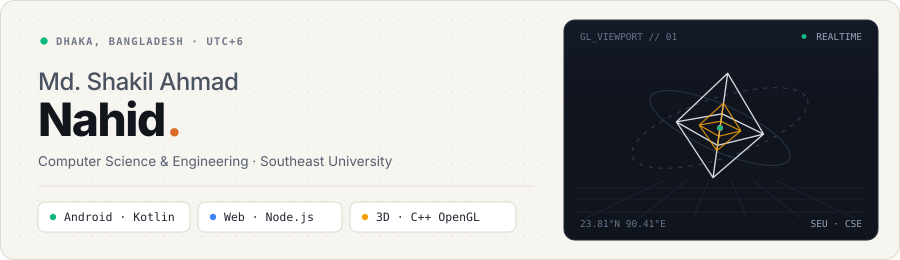
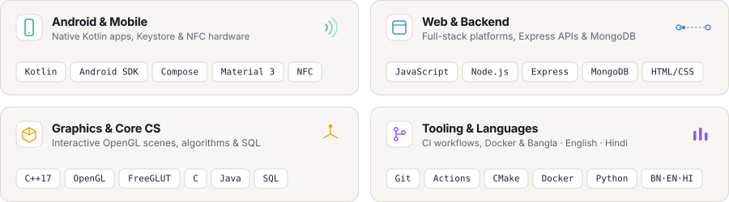
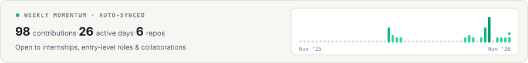

<picture>
  <source media="(prefers-color-scheme: dark)" srcset="assets/profile/hero-dark.svg" />
  <source media="(prefers-color-scheme: light)" srcset="assets/profile/hero-light.svg" />
  
</picture>

 

Studying **Computer Science & Engineering** at **Southeast University** in Dhaka, focused on building native Android apps in Kotlin, full-stack web applications in JavaScript, and real-time 3D graphics in C++ and OpenGL. Earlier work in sales and online business taught me to pay attention to how people actually use a tool, not just how it's written.

 

<picture>
  <source media="(prefers-color-scheme: dark)" srcset="assets/profile/stack-dark.svg" />
  <source media="(prefers-color-scheme: light)" srcset="assets/profile/stack-light.svg" />
  
</picture>

 

<picture>
  <source media="(prefers-color-scheme: dark)" srcset="assets/profile/activity-dark.svg" />
  <source media="(prefers-color-scheme: light)" srcset="assets/profile/activity-light.svg" />
  
</picture>

 

  <a href="mailto:shakilahmad42052@gmail.com"><picture><source media="(prefers-color-scheme: dark)" srcset="assets/profile/btn-email-dark.svg" /></picture></a>&nbsp;&nbsp;
  <a href="https://www.facebook.com/shakilahmad42052"><picture><source media="(prefers-color-scheme: dark)" srcset="assets/profile/btn-facebook-dark.svg" /></picture></a>&nbsp;&nbsp;
  <a href="https://github.com/shakil42051?tab=repositories"><picture><source media="(prefers-color-scheme: dark)" srcset="assets/profile/btn-repos-dark.svg" /></picture></a>

