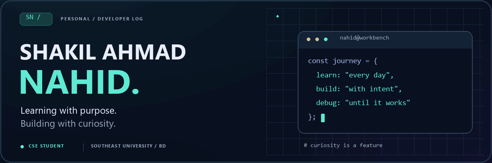
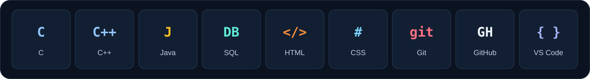
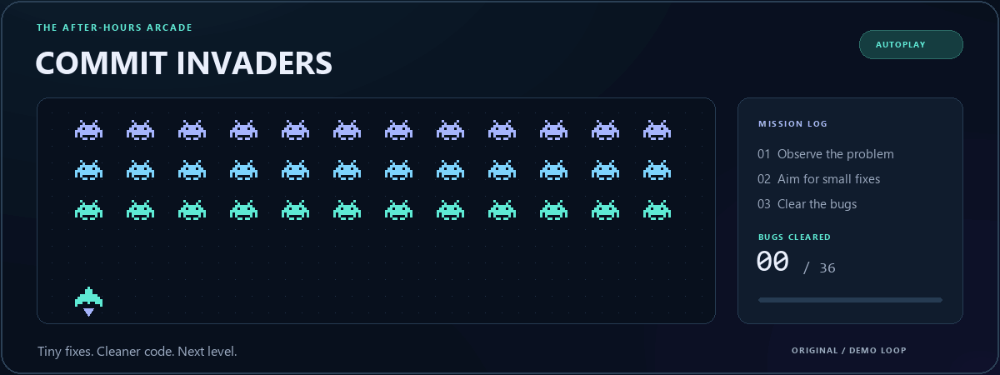

<div align="center">

<picture>
  <source media="(prefers-reduced-motion: reduce)" srcset="assets/profile/hero.png" />
  
</picture>

<br />

**Computer Science & Engineering student · Southeast University · Bangladesh**

Turning classroom concepts into practical projects, one thoughtful iteration at a time.

<a href="mailto:shakilahmad42052@gmail.com"></a>
<a href="https://github.com/shakil42051?tab=repositories"></a>
<a href="https://www.facebook.com/shakilahmad42052"></a>

<br /><br />

<a href="#about">About</a> &nbsp; / &nbsp;
<a href="#toolkit">Toolkit</a> &nbsp; / &nbsp;
<a href="#projects">Projects</a> &nbsp; / &nbsp;
<a href="#arcade">Arcade</a> &nbsp; / &nbsp;
<a href="#activity">Activity</a> &nbsp; / &nbsp;
<a href="#connect">Connect</a>

</div>

<br />

<a id="about"></a>
## 01 &nbsp; A little about the builder

Hi, I'm **Md. Shakil Ahmad Nahid**. I'm studying **B.Sc. in Computer Science & Engineering at Southeast University**, strengthening my programming foundations and exploring how useful software comes together.

My experience in **sales, customer service, and online business** has taught me to listen carefully, communicate clearly, and work through practical problems. I bring that same approach to learning technology: understand the need, break down the problem, and keep improving the solution.

| Right now | Where I'm heading |
| :--- | :--- |
| Practising programming, data structures, and algorithms | Build a stronger foundation for software development |
| Learning databases and application workflows | Create useful, clearly documented projects |
| Exploring web development and AI/ML concepts | Connect new ideas with practical use cases |
| Developing communication and teamwork | Contribute to student projects and entry-level opportunities |

> **My approach:** understand it → build it → test it → explain it → improve it.

<br />

<a id="toolkit"></a>
## 02 &nbsp; My learning toolkit



| Area | What I'm developing |
| :--- | :--- |
| **Programming & problem solving** | C, C++, Java fundamentals; data structures; algorithmic thinking |
| **Data & applications** | Relational database concepts, SQL, web and application development |
| **Tools & workflow** | Git, GitHub, VS Code, productivity and digital tools |
| **Next to explore** | AI and machine learning foundations and practical applications |

<sub>These are technologies I study and explore. My focus is steady progress and useful work.</sub>

<br />

<a id="projects"></a>
## 03 &nbsp; From the classroom to the workbench

A selection of my academic project areas and practice work:

| Project area | Learning focus |
| :--- | :--- |
| **🎟️ Movie Ticket Booking System** | Application logic, booking workflows, and data handling |
| **🗃️ Programming & Database Projects** | Structured programs, relational data, and queries |
| **🧩 Data Structures & Algorithms** | Implementations, problem decomposition, and efficiency |
| **⚙️ Digital Logic & Microprocessor Labs** | Logical reasoning and hardware-oriented computing concepts |

<a href="https://github.com/shakil42051?tab=repositories"><b>Explore my public repositories →</b></a>

<details>
<summary><b>🧭 What I'm working toward next</b></summary>

- [ ] Publish a project with clear setup instructions and screenshots.
- [ ] Build a consistent problem-solving and documentation habit.
- [ ] Improve my understanding of database and application design.
- [ ] Collaborate on a student project or a beginner-friendly open-source issue.

</details>

<br />

<a id="arcade"></a>
## 04 &nbsp; Take a break. Enter the arcade.

<picture>
  <source media="(prefers-reduced-motion: reduce)" srcset="assets/profile/commit-invaders.png" />
  
</picture>

<p align="center"><sub>COMMIT INVADERS · Original animated arcade loop · Just for fun, independent of GitHub statistics.</sub></p>

### 🎮 Your turn: defeat the off-by-one boss

The ship's energy cells live in a C array. One line causes an invalid memory access. **Choose a fix below.**

```c
int energy[3] = {10, 20, 30};
for (int i = 0; i <= 3; i++) {
    printf("%d\n", energy[i]);
}
```

<details>
<summary><b>🅰️ Start the loop at i = 1</b></summary>

**The boss survives.** You skip `energy[0]`, and the loop still reaches `energy[3]`. A three-element C array has valid indices `0`, `1`, and `2`.

Close this option and try another route.

</details>

<details>
<summary><b>🅱️ Change the condition to i &lt; 3</b></summary>

**Boss defeated!** The loop now visits exactly the valid indices: `0`, `1`, and `2`.

```c
for (int i = 0; i < 3; i++) {
    printf("%d\n", energy[i]);
}
```

**Bonus round:** Why does a binary search work on a sorted array?

<details>
<summary><b>It can discard half of the remaining search space after each comparison.</b></summary>

**Achievement unlocked: thoughtful debugger. 🏆**

The sorted order tells you which half can contain the target. Repeating that step gives binary search its `O(log n)` search time.

Take your curiosity into the next project. That's where the real level-ups happen.

</details>

<details>
<summary><b>It compares every element from left to right.</b></summary>

That describes a linear search. Binary search uses sorted order to eliminate half the remaining possibilities at each step. Try the other answer!

</details>

</details>

<details>
<summary><b>🅲 Increase the array size to 4</b></summary>

**A workaround, but the boss returns.** A four-element array makes this particular access valid, yet it adds an extra element and changes the output. The intended job is to visit the original three energy cells.

Fix the loop's boundary and try again.

</details>

<p align="center"><sub>Click-to-reveal game built with GitHub's expandable Markdown sections. No installation needed.</sub></p>

<br />

<a id="activity"></a>
## 05 &nbsp; A little progress, every day


<p align="center">
  <a href="https://github.com/shakil42051?tab=overview">Contribution overview</a> &nbsp; · &nbsp;
  <a href="https://github.com/shakil42051?tab=repositories">Public repositories</a>
</p>

<sub>The activity card refreshes daily after the included GitHub Actions workflow runs. First-time setup: <a href="START_HERE.md">START_HERE.md</a>.</sub>

<br />

<a id="connect"></a>
## 06 &nbsp; Let's build something useful

I'm open to **student collaborations, learning together, and entry-level opportunities** where I can contribute, take responsibility, and grow.

Have a project idea, a learning resource, or a beginner-friendly issue? I'd love to hear about it.

**[Send me an email](mailto:shakilahmad42052@gmail.com)** &nbsp; · &nbsp; **[Follow on GitHub](https://github.com/shakil42051)** &nbsp; · &nbsp; **[Connect on Facebook](https://www.facebook.com/shakilahmad42052)**

**Languages:** Bangla · English · Hindi

<br />

<div align="center">


<sub>Thanks for visiting. Come back to see what I build next.</sub>

</div>
